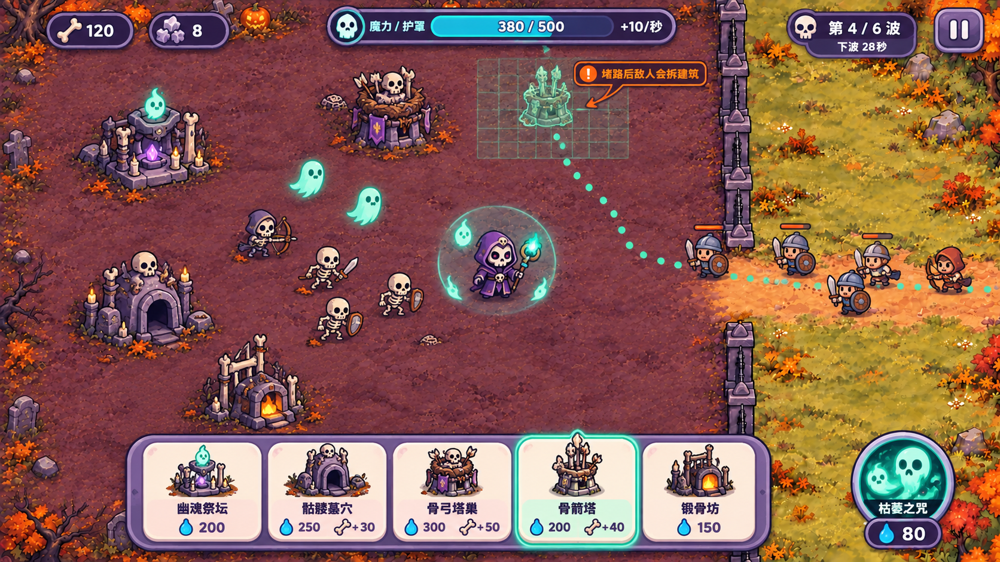
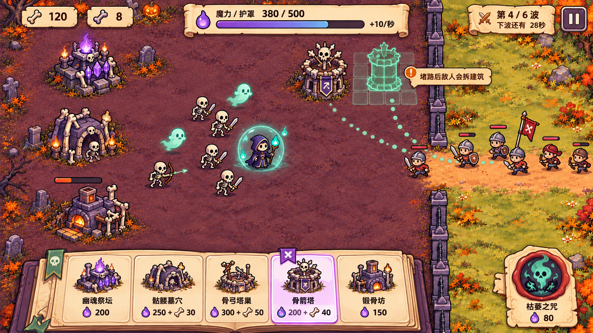
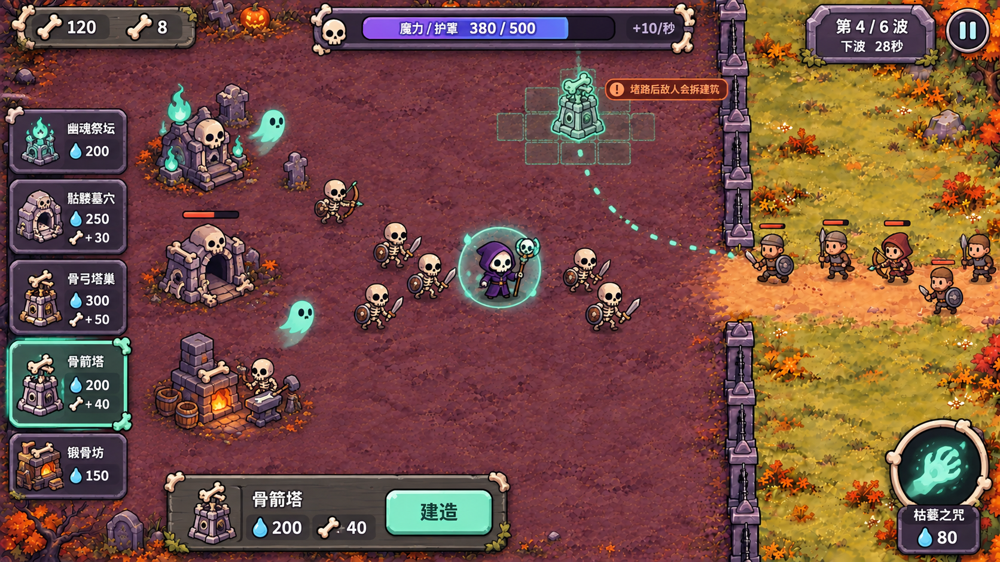

# 梦想成为亡灵大师

TapTap Maker 游戏 Demo 的设计与美术交接仓库。

当前玩法仍待实现：`scripts/main.lua` 是空玩法基线，本次交接主要提供设计文档、地图、角色／建筑素材和 UI 概念方案。

## 网页端开发入口

先阅读 [开发交接说明](docs/Tap网页端开发交接.md)，再依据 [Demo GDD v0.1](docs/梦想成为亡灵大师_Demo_GDD_v0.1.md) 实现。

- [UI 设计方向与选择建议](docs/UI设计方向_v0.1.md)
- [地图与资产尺寸规范](docs/地图与资产尺寸规范.md)
- 主战场背景：`assets/image/battlefield_main.png`
- 现有美术素材：`assets/image/`

## 三版 UI 概念

目前尚未由用户选定最终方向。A 为推荐默认方案，B 偏故事与经营，C 偏营地与战术。

### A：幽灵糖果

### B：墓园手账

### C：骨木营地

效果图用于视觉参考，不是已运行的游戏截图。正式 UI 请使用真实文字、资源图标与可交互控件重新制作。
